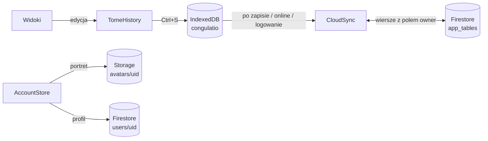
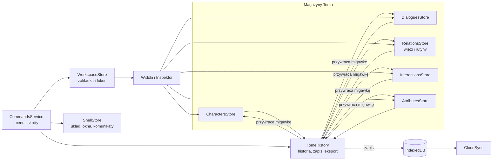

# Congulatio

> Kuźnia światów RPG: twórz postacie i ich trójwymiarowe sylwetki, pisz rozgałęzione dialogi, planuj rutyny dnia,
> mapuj relacje i interakcje, a potem sprawdź w symulacji, jak bohaterowie o różnych motywacjach rozegrają scenę.

Congulatio to aplikacja webowa (Angular 22) dla projektantów gier fabularnych. Cały świat — postacie, dialogi, więzi,
rutyny, interakcje i własne atrybuty — mieszka w jednym **Tomie**, który ma pełną historię zmian z cofaniem i
ponawianiem, zapis we wbudowanej bazie przeglądarki (IndexedDB), opcjonalne konto z synchronizacją w chmurze
(Firebase: logowanie, Firestore, Storage) oraz eksport i import do pliku JSON. Aplikacja działa **offline-first** —
konto nie jest wymagane.

Aktualna wersja: **0.1.0** — zmiany opisuje [`CHANGELOG.md`](CHANGELOG.md).

Projekt powstał jako praca uczelniana. Autor: **Adrian Blasiak**.

Pojęcia świata (Tom, dusza, rutyna, interakcja, scena…), zależności między nimi oraz reguły pierwszeństwa opisuje
[słownik pojęć](docs/glossary.md).

---

## Spis treści

1. [Najważniejsze funkcje](#najważniejsze-funkcje)
2. [Szybki start](#szybki-start)
3. [Konto, chmura i Firebase](#konto-chmura-i-firebase)
4. [Skrypty npm](#skrypty-npm)
5. [Skróty klawiszowe](#skróty-klawiszowe)
6. [Architektura](#architektura)
7. [Model danych i plik Tomu](#model-danych-i-plik-tomu)
8. [Story AI (Chrome Prompt API)](#story-ai-chrome-prompt-api)
9. [Animacje z Mixamo](#animacje-z-mixamo)
10. [Testy](#testy)
11. [Wdrożenie na GitHub Pages](#wdrożenie-na-github-pages)
12. [Wydajność i budżety](#wydajność-i-budżety)
13. [Dostępność](#dostępność)
14. [Wersjonowanie i lista zmian](#wersjonowanie-i-lista-zmian)
15. [Konwencje projektu](#konwencje-projektu)
16. [Znane ograniczenia](#znane-ograniczenia)
17. [Wykorzystanie AI](#wykorzystanie-ai)
18. [Autor i licencja](#autor-i-licencja)

---

## Najważniejsze funkcje

Interfejs aplikacji jest w języku angielskim; poniżej nazwy elementów podano tak, jak wyglądają w aplikacji.

### Lewy panel (nawigatory)

| Sekcja | Co robi |
| --- | --- |
| **Codex of Characters** | Lista wszystkich postaci („dusz”) z portretem, rasą, poziomem i statusem. Kliknięcie ładuje postać do Kuźni i Inspektora. Kosz (lub Delete) usuwa duszę po potwierdzeniu w oknie, które w akordeonach pokazuje wszystko, co odejdzie razem z nią: więzi, interakcje, rutyny osobiste, udział w rutynach globalnych i sceny, w których mówi (do wyboru). |
| **Routine Almanac** | Globalne rutyny świata (np. dzień targowy, nocna warta): pora dnia, harmonogram, miejsce, liczba uczestników. Dodawanie, edycja i usuwanie z walidacją. |
| **Attribute Ledger** | Własne atrybuty (klucz, nazwa, zakres, wartość domyślna, opis) obok sześciu podstawowych (STR, DEX, INT, WIS, CON, CHA). |
| Dialogue Threads, Quest Board, World Atlas | Miejsca zarezerwowane na kolejne moduły — na razie puste. |

Sekcje można otwierać jednocześnie, zmieniać ich wysokość przeciąganiem separatora (podwójne kliknięcie wyrównuje) i
szerokość całego panelu przeciąganiem prawej krawędzi.

### Zakładki główne

| Zakładka | Co robi |
| --- | --- |
| **Character** (Kuźnia) | „Summon Soul” losuje spójną postać (imię, rasa, cechy, znak zodiaku zgodny z datą urodzenia, portret 8-bit). Edycja tożsamości i wyglądu, zapis do Kodeksu z komunikatem sukcesu lub błędu. |
| **Sculptor** | Low-poly model 3D (three.js): suwaki z zakresami (wzrost, tusza, oczy, nogi, ręce, dłonie, klatka piersiowa u kobiet), presety sylwetki, fryzury i kolory włosów, **Make Avatar** (zrzut głowy jako portret postaci) oraz odtwarzanie animacji z Mixamo. |
| **Dialogue** | Trzy podzakładki: **Tree** (płaska lista scen z poziomami, filtrami i przypiętymi etykietami scen), **Story Composer** (pisanie gałęzi oraz panel Story AI) i **Variants & Impact** (warianty tonu, wpływ na ekonomię, środowisko i nastawienie, wspólne cele i przeszkody z autouzupełnianiem). |
| **Routines** | Plan dnia wybranej postaci od świtu do północy: dołączanie do rutyn globalnych, tworzenie rutyn osobistych, rozgałęzienia rutyn w dialogi, wykrywanie kolizji w tej samej porze. |
| **Interactions** | Rejestr interakcji (walka, handel, zadanie, zaklęcie, kradzież, rozmowa, prezent, groźba): źródło, cel, wyzwalacz z autouzupełnianiem, powiązany dialog, filtry i sortowanie. |
| **Relations** | Mapa relacji (SVG): dusze, rutyny i dialogi, w które rutyny się rozgałęziają. Wędrówka po powiązaniach, tworzenie i zrywanie więzi. |
| **Simulation** | Wybór scenariusza, postaci i motywacji (bogactwo, honor, bezpieczeństwo, ciekawość, więzi, władza). Postać wybiera opcje zgodnie z motywami i temperamentem, rozmówcy odpowiadają wariantem tonu wynikającym z relacji, a wynik sumuje wpływ na świat. |

### Drzewo dialogów (Tree)

- Każdy krok pokazuje poziom (L1–L5), typ interakcji („Started conversation”, „Reacted”, „Stole an item”…), mówiącego,
  tekst, wpływ oraz uporządkowaną listę **następnych kroków**. Kliknięcie przewija do celu i podświetla go.
- **Filtry:** dusze biorące udział (multiselect), tekst (każde słowo osobno, z podświetleniem trafień), sceny
  połączone lub samodzielne, tylko linie lub tylko opcje, typ interakcji, szkice AI, kroki z wpływem, zakres poziomów
  „od–do”.
- **Kolejność:** czytania albo **według poziomów** (rodzeństwo obok siebie, łatwe porównanie opcji).
- **Przypięte etykiety scen:** każda scena ma kolorowy pasek z numerem, identyfikatorem i tytułem, który zostaje
  widoczny podczas przewijania (jak zamrożone okienko).
- **Usuwanie kroków:** okno z akordeonem gałęzi i polami wyboru. Zaznaczone kroki są usuwane, a pozostawione kroki,
  których rodzic zniknął, stają się **samodzielnymi scenami**. Podsumowanie pokazuje też odcięte rozgałęzienia rutyn
  i interakcje, które przestaną otwierać dialog.
- **Samodzielne linie:** nowa linia lub opcja bez rodzica, od której można dalej pisać.

### Inspektor (prawy panel)

Pokazuje i edytuje to, co jest aktualnie w **fokusie** — duszę, rutynę, krok dialogu lub interakcję. Fokus ustawiają
Kodeks, Kuźnia, mapa relacji, lista dialogów, Rzeźbiarz, Symulacja i wyszukiwarka, a mapa i lista dialogów same
podążają za zmianą fokusu.

- Dusza: poziom, status, temperament, pochodzenie, atrybuty podstawowe i własne, relacje, rutyny, sceny, interakcje.
- **Atrybuty:** kliknięcie liczby kopiuje oznaczony token, np. `[[Aldric Blackwood.STR=78]]`; podwójne kliknięcie
  pozwala wpisać dokładną wartość (Enter zapisuje, Esc anuluje, wartość jest sprawdzana względem zakresu).
- **Tryb tylko do odczytu** (kłódka w nagłówku): dane jako zwykły tekst, bez możliwości edycji; linki, nawigacja i
  kopiowanie działają dalej. Ustawienie jest zapamiętywane w przeglądarce.

### Tom, historia i menu

- **File:** zapis Tomu wraz z dziennikiem zmian w przeglądarce, otwarcie Tomu z pliku, eksport (z pełną historią lub
  bez), **Account & storage…** (konto, portret, limity), **Sync with the cloud now**, reset do danych przykładowych (z
  potwierdzeniem; reset da się cofnąć).
- **Edit:** cofnij i ponów dla wszystkich danych oraz okno **History & changeset** z osią czasu i powrotem do dowolnego
  kroku. Szybkie serie edycji (pisanie, przeciąganie suwaka) są łączone w jeden krok.
- **View:** pokazywanie i ukrywanie paneli, tryb tylko do odczytu Inspektora, **presety układu** z dobranymi
  szerokościami paneli, maksymalizacja sceny, pełny ekran, przejście do zakładki.
- **Tools:** przywołanie losowej duszy, rzeźbienie duszy w fokusie, symulacja, mapa.
- **Help:** **Quick tour** (przewodnik krok po kroku oraz tabela skrótów budowana z tej samej listy poleceń, która
  obsługuje klawiaturę), **What’s new** i **About**.
- **Wyszukiwarka Tomu** w górnym pasku (⌘/Ctrl+K): postacie (`Imię Nazwisko (przydomek)`), linie, opcje, rutyny,
  więzi, interakcje i polecenia menu, każda kategoria z własnym kolorem etykiety. Wybór wyniku przenosi do właściwej
  sekcji.
- **Pasek stanu:** stan zapisu, krok historii, aktualny fokus, liczności Tomu, stan synchronizacji z chmurą oraz
  komunikaty.
- **Konto** (okrągły portret w prawym górnym rogu, kropka pokazuje stan synchronizacji; bez konta obok jest przycisk
  **Sign in**): okno **Account & storage** z portretem, nazwą, licznikiem miejsca w chmurze i w przeglądarce,
  korzyściami z konta oraz wylogowaniem.
- **Okno powitalne:** przy pierwszej wizycie wita, wyjaśnia, że konto nie jest potrzebne, pokazuje nowości i korzyści
  z konta. Po każdej aktualizacji pokazuje **What’s new** z nowościami od ostatnio widzianej wersji (raz na wersję;
  zawsze dostępne w Help → What’s new).

### Konto jest opcjonalne (offline-first)

Aplikacja od razu otwiera warsztat z Tomem zapisanym w tej przeglądarce. Logowanie (`/login`) jest dostępne z
przycisku **Sign in**, okna powitalnego i okna konta:

| Tryb | Co się dzieje |
| --- | --- |
| **Bez konta** (domyślnie) | Nic nie opuszcza przeglądarki; Tom żyje w IndexedDB i przetrwa zamknięcie przeglądarki. Działa też wtedy, gdy build nie ma konfiguracji Firebase. |
| **Account** (e-mail i hasło lub Google) | Tom jest zapisywany w przeglądarce i synchronizowany z Firestore, więc działa na każdym urządzeniu. Domyślnie 20 MiB w chmurze i portret konta. |
| **Wanderer** (anonimowo) | Konto anonimowe Firebase przypięte do tej przeglądarki, z synchronizacją i limitem 2 MiB. W oknie konta można je później **połączyć** z e-mailem lub Google — dane i identyfikator zostają. Wylogowanie wędrowca bez połączenia traci kopię w chmurze (aplikacja ostrzega). |

- **Nowe** konto lub wędrowiec zaczyna z Tomem, który jest właśnie otwarty. Logowanie do **istniejącego** konta
  nigdy nie nadpisuje jego Tomu w chmurze lokalną pracą — Tom bez konta zostaje w przeglądarce.
- Wylogowanie wraca do Tomu bez konta zapisanego w tej przeglądarce.

---

## Szybki start

**Wymagania:** Node.js 26 (zob. `.nvmrc`) i npm 12 (zob. pole `packageManager` w `package.json`).

```bash
npm ci
npm start
```

Aplikacja uruchomi się pod adresem `http://localhost:4200/` i będzie przeładowywać się po każdej zmianie w kodzie.

Aplikacja od razu otwiera warsztat — konto nie jest potrzebne. Bez konfiguracji Firebase przycisk **Sign in** jest
ukryty, a wszystko inne działa normalnie. Jak włączyć konto i chmurę, opisuje [następna sekcja](#konto-chmura-i-firebase); najszybciej
lokalnie przez emulatory:

```bash
npm run emulators         # terminal 1: emulatory Auth, Firestore i Storage (wymaga Javy 11+)
npm run start:emulators   # terminal 2: aplikacja podłączona do emulatorów
```

Przy pierwszym uruchomieniu Tom zawiera dane przykładowe (pięć dusz, trzy sceny, rutyny, więzi, interakcje i dwa
własne atrybuty). Zapis (⌘/Ctrl+S) przechowuje Tom w **IndexedDB** przeglądarki (osobno dla każdego konta), więc
przetrwa przeładowanie i zamknięcie przeglądarki. Tom zapisany przez starsze wersje w `localStorage` jest przy
pierwszym otwarciu automatycznie przenoszony do IndexedDB.

---

## Konto, chmura i Firebase

### Jak to działa



- **Offline-first.** Bez logowania aplikacja działa w pełni na Tomie właściciela `local`. Po zalogowaniu
  `tomeGuard` otwiera Tom zalogowanego użytkownika (nowe konto dostaje kopię otwartego Tomu).
- **Najpierw przeglądarka.** Zapis zawsze trafia do IndexedDB (`tomes`, `sync`, `settings`), a dopiero potem do
  chmury. Bez sieci aplikacja działa dalej i synchronizuje się po powrocie połączenia.
- **Synchronizacja** dzieli Tom na wiersze kolekcji `app_tables` — jeden na duszę, krok dialogu, więź, rutynę,
  interakcję i atrybut, plus wiersz `meta` z czasem zapisu i zajętością. Identyfikator wiersza to
  `<uid>~<rodzaj>~<id>`, a każdy wiersz ma pole `owner` równe `uid`. Wysyłane są tylko zmienione wiersze (skróty
  treści w IndexedDB), usunięte elementy są kasowane.
- **Konflikty:** gdy Tom zmienił się i w chmurze, i w przeglądarce, wygrywa nowszy zapis. Pobranie z chmury jest
  zwykłym krokiem historii, więc **Undo** przywraca wersję z przeglądarki.
- **Limity miejsca:** okno konta pokazuje zajętość (Tom + portret) względem limitu. Domyślnie 2 MiB dla wędrowca i
  20 MiB dla konta; limit można nadać indywidualnie przez custom claim `storageQuota` (w bajtach), patrz niżej.
  Gdy Tom przekracza limit, synchronizacja się zatrzymuje, a Tom zostaje bezpiecznie w przeglądarce.
- **Portrety** są przycinane do kwadratu i zmniejszane do 256 px (WebP, maks. 512 KiB) przed wysłaniem do Storage
  (`avatars/<uid>/`). W trybie offline portret zostaje w IndexedDB.
- Biblioteka Firebase ładuje się **leniwie** — paczka startowa jej nie zawiera.

### Skąd aplikacja bierze ustawienia Firebase

Konfiguracja nie jest wpisana w kod. Aplikacja przy starcie pobiera plik `public/firebase-config.json`, który jest
**w `.gitignore`** i generuje go skrypt `scripts/firebase-config.mjs`. Brak pliku = tryb tylko offline.

Kolejność pierwszeństwa (wyższa wygrywa):

1. **Zmienne środowiskowe `FIREBASE_*`** — w GitHub Actions to sekrety repozytorium (a gdy sekretu brak, zmienne
   repozytorium `vars.*`).
2. Plik **`.env.local`** (lub inny wskazany przez `FIREBASE_ENV_FILE`) — do pracy lokalnej i etapu testowego.
3. Ręcznie napisany `public/firebase-config.json` bez pola `"generated": true` — skrypt go nie nadpisze, jeśli nie
   ma innych ustawień.

| Zmienna | Znaczenie |
| --- | --- |
| `FIREBASE_API_KEY`, `FIREBASE_AUTH_DOMAIN`, `FIREBASE_PROJECT_ID`, `FIREBASE_APP_ID` | Wymagane (z konsoli Firebase → Project settings → Your apps → Web app). |
| `FIREBASE_STORAGE_BUCKET`, `FIREBASE_MESSAGING_SENDER_ID`, `FIREBASE_MEASUREMENT_ID` | Opcjonalne. |
| `FIREBASE_STAGE` | Nazwa etapu, np. `testing`; inna niż `production` jest widoczna jako plakietka na stronie logowania. |
| `FIREBASE_EMULATORS` | `true` = łącz się z lokalnymi emulatorami (bez prawdziwego projektu wystarczy samo to). |
| `FIREBASE_EMULATOR_HOST` | Host emulatorów, domyślnie `127.0.0.1`. |

### Lokalnie: projekt testowy

1. W [konsoli Firebase](https://console.firebase.google.com/) utwórz osobny projekt na etap testowy (np.
   `congulatio-testing`) i dodaj aplikację webową.
2. **Authentication → Sign-in method:** włącz **Anonymous**, **Email/Password** i **Google**.
3. **Authentication → Settings → Authorized domains:** `localhost` jest tam domyślnie.
4. **Firestore Database:** utwórz bazę. **Storage:** utwórz bucket (nowe buckety wymagają planu Blaze; bez Storage
   wszystko działa poza wysyłaniem portretów).
5. Skopiuj ustawienia do pliku lokalnego i uruchom aplikację:

   ```bash
   cp .env.example .env.local   # uzupełnij wartości FIREBASE_*
   npm start                    # skrypt sam wygeneruje public/firebase-config.json
   ```

6. Wgraj reguły bezpieczeństwa (patrz niżej).

### Lokalnie: emulatory (bez żadnego projektu)

```bash
npm run emulators         # Auth :9099, Firestore :8080, Storage :9199, UI na http://127.0.0.1:4000
npm run start:emulators   # aplikacja z projektem demo-congulatio podłączona do emulatorów
```

Emulatory używają reguł z `firestore.rules` i `storage.rules`, więc to najlepsze miejsce, żeby je sprawdzać. W UI
emulatorów widać użytkowników, wiersze `app_tables` i pliki portretów. `npm start` po pracy na emulatorach znów
generuje ustawienia z `.env.local` (albo usuwa wygenerowany plik, jeśli ustawień nie ma).

### GitHub Pages: sekrety repozytorium

1. Utwórz (najlepiej osobny) projekt produkcyjny i włącz te same metody logowania.
2. **Authorized domains:** dodaj `<użytkownik>.github.io`.
3. W repozytorium: **Settings → Secrets and variables → Actions → New repository secret** dodaj `FIREBASE_API_KEY`,
   `FIREBASE_AUTH_DOMAIN`, `FIREBASE_PROJECT_ID`, `FIREBASE_APP_ID` oraz opcjonalnie `FIREBASE_STORAGE_BUCKET`,
   `FIREBASE_MESSAGING_SENDER_ID`, `FIREBASE_MEASUREMENT_ID`, `FIREBASE_STAGE`.
4. Krok **Write Firebase settings from GitHub secrets** w workflow zapisze `firebase-config.json` przed buildem.
   Plik `.env.local` nie istnieje w CI i nie jest czytany. Bez sekretów build wychodzi w trybie tylko offline.

> **Czy klucz API to sekret?** Nie do końca. Konfiguracja webowa Firebase jest identyfikatorem projektu i trafia do
> przeglądarki każdego odwiedzającego — zobaczy ją każdy w narzędziach deweloperskich. Trzymanie jej w sekretach
> chroni repozytorium przed przypadkowymi forkami i botami, ale **prawdziwą ochroną są reguły bezpieczeństwa**, lista
> Authorized domains oraz ograniczenie klucza w Google Cloud Console (**APIs & Services → Credentials → klucz →
> Application restrictions: Websites**, np. `https://<użytkownik>.github.io/*` i `http://localhost:*`). Rozważ też
> [App Check](https://firebase.google.com/docs/app-check).

### Reguły bezpieczeństwa

Pliki `firestore.rules` i `storage.rules` leżą w repozytorium. Wgrywanie:

```bash
npx -y firebase-tools@15.34.2 login
npx -y firebase-tools@15.34.2 deploy --only firestore:rules,storage --project <id-projektu>
```

Co pilnują reguły Firestore:

- `users/{uid}` — czyta i pisze tylko właściciel (oraz admin czyta); dozwolone wyłącznie pola profilu, więc nikt nie
  dopisze sobie np. `admin: true` ani limitu.
- `app_tables/{id}` — **odczyt tylko własnych wierszy** (`resource.data.owner == auth.uid`); tworzenie tylko z
  `owner == auth.uid` **i** identyfikatorem zaczynającym się od `<uid>~` (nikt nie zajmie cudzego identyfikatora);
  zmiana tylko własnych wierszy bez zmiany właściciela; usuwanie tylko własnych; ograniczona lista pól i rozmiar
  `json` do ok. 900 kB.
- `admin_tables` — tylko z custom claimem `admin: true`; wszystko inne zamknięte.

Storage: `avatars/{uid}/…` — zapis tylko właściciela, obraz WebP/PNG/JPEG do 512 KiB; reszta zamknięta.

### Indywidualne limity i administratorzy (custom claims)

Custom claims ustawia się Admin SDK z zaufanego miejsca (np. lokalnie z kluczem konta serwisowego), nigdy z
przeglądarki:

```js
import { initializeApp, applicationDefault } from 'firebase-admin/app';
import { getAuth } from 'firebase-admin/auth';

initializeApp({ credential: applicationDefault() });
await getAuth().setCustomUserClaims('<uid>', { storageQuota: 50 * 1024 * 1024, admin: false });
```

Użytkownik zobaczy nowy limit po kliknięciu **refresh** w oknie konta (lub po ponownym zalogowaniu).

### Wskazówki i rozwiązywanie problemów

- **„This site is not on the authorised domains list”** — dodaj domenę w Authentication → Settings → Authorized
  domains.
- **„This sign-in method is turned off”** — włącz metodę w Authentication → Sign-in method.
- **„The cloud refused the request. Check the security rules.”** — reguły nie są wgrane albo projekt ma stare
  reguły (np. bez `allow delete` dla `app_tables` usuwanie elementów Tomu nie zsynchronizuje się).
- **Okno Google się nie otwiera** — przeglądarka blokuje wyskakujące okna dla tej strony.
- **Portret się nie wysyła** — projekt nie ma bucketu Storage (plan Blaze) albo brakuje `FIREBASE_STORAGE_BUCKET`.
- **Przeglądarka może wyczyścić dane** przy braku miejsca na dysku — w oknie konta kliknij **Ask to keep it**, aby
  poprosić o trwałe przechowywanie, a ważne Tomy dodatkowo eksportuj do pliku.
- **Emulatory nie startują** — sprawdź Javę (`java -version`, wymagana 11+) i czy porty 4000, 4400, 8080, 9099, 9199
  są wolne.
- Bieżące ustawienia widać w `public/firebase-config.json` (w narzędziach deweloperskich: zakładka Network).

---

## Skrypty npm

| Skrypt | Działanie |
| --- | --- |
| `npm start` | Generuje ustawienia Firebase z `.env.local` i uruchamia serwer deweloperski (`ng serve`). |
| `npm run start:emulators` | Serwer deweloperski podłączony do lokalnych emulatorów Firebase. |
| `npm run emulators` | Emulatory Firebase (Auth, Firestore, Storage) z regułami z repozytorium. |
| `npm run config:firebase` | Tylko generuje `public/firebase-config.json` (zmienne `FIREBASE_*` lub `.env.local`). |
| `npm run build` | Generuje ustawienia Firebase i buduje wersję produkcyjną do `dist/congulatio/browser`. |
| `npm run build:pages` | Jak `build`, ale z `--base-href /congulatio/`, czyli tak jak na GitHub Pages. |
| `npm run watch` | Build deweloperski w trybie obserwowania zmian. |
| `npm test` | Testy jednostkowe (Vitest przez `ng test`) w trybie obserwowania. |
| `npm run test:ci` | Testy jednostkowe jednorazowo, bez obserwowania (używane w CI). |
| `npm run e2e` | Ciężkie testy end-to-end na emulatorach i headless Chrome — tylko na żądanie (zob. [Testy](#testy)). |

---

## Skróty klawiszowe

Na macOS zamiast Ctrl używaj ⌘, a zamiast Alt — ⌥. Pełna, zawsze aktualna lista jest w aplikacji: **Help → Quick
tour → Shortcuts** (F1).

| Działanie | Skrót |
| --- | --- |
| Zapisz Tom | Ctrl+S |
| Otwórz Tom z pliku | Ctrl+O |
| Eksportuj Tom | Ctrl+Shift+E |
| Cofnij / Ponów | Ctrl+Z / Ctrl+Shift+Z lub Ctrl+Y |
| Historia i dziennik zmian | Ctrl+Shift+H |
| Szukaj w Tomie | Ctrl+K |
| Panel Kodeksu / Inspektor | Ctrl+B / Ctrl+Alt+B |
| Inspektor tylko do odczytu | Ctrl+Alt+R |
| Maksymalizuj scenę / Pełny ekran | Ctrl+Alt+M / Ctrl+Alt+F |
| Zakładki 1–7 (Character … Simulation) | Alt+1 … Alt+7 |
| Przywołaj losową duszę | Ctrl+Alt+N |
| Szybki przewodnik | F1 lub ? |
| Usuń krok dialogu (w drzewie) lub duszę (w Kodeksie) | Delete |

Cofnij i ponów celowo nie działają wewnątrz pól tekstowych — tam obowiązuje natywne cofanie przeglądarki. W menu,
listach, zakładkach i polach z podpowiedziami działają strzałki, Home/End, Enter i Esc.

---

## Architektura

### Stos technologiczny

| Obszar | Technologia |
| --- | --- |
| Framework | Angular 22 (komponenty standalone, sygnały, nowa składnia szablonów `@if` / `@for` / `@defer`, API `animate.enter`) |
| Stan | NgRx Signals (`signalStore`) i serwisy oparte na sygnałach |
| 3D | three.js 0.180 (`OrbitControls`, `FBXLoader`) |
| Chmura | Firebase 13 (Auth, Firestore, Storage), ładowany leniwie |
| Dane lokalne | IndexedDB (własna, lekka nakładka `TomeVault`) |
| Ikony | Lucide |
| Style | CSS z tokenami motywu w `src/styles.css`, Tailwind CSS 4 (tylko warstwa bazowa) |
| Testy | Vitest 5 + jsdom przez `@angular/build:unit-test`; e2e: puppeteer-core + emulatory Firebase |
| Język | TypeScript 6 |

`primeng` i `@primeuix/themes` są zainstalowane, ale obecnie nigdzie nieużywane.

### Struktura katalogów

```text
src/app/
├── domain/              czyste funkcje i typy domenowe (bez Angulara) + testy
├── store/               stan aplikacji: magazyny NgRx Signals, historia Tomu, IndexedDB (TomeVault)
├── cloud/               Firebase: ustawienia, sesja i logowanie, guardy tras, synchronizacja, konto i portrety
├── login/               opcjonalna strona logowania (/login)
├── workbench/           główny warsztat (dawny komponent App, ładowany leniwie jako trasa /)
├── layout/              górny pasek, menu, wyszukiwarka, okna dialogowe, pasek stanu, polecenia i skróty
├── ui/                  współdzielone komponenty UI (panel, przyciski, zakładki, modal, comboboxy, awatar)
├── navigator/           lewy panel i jego sekcje
├── characters-galery/   Codex of Characters
├── routines-almanac/    Routine Almanac (rutyny globalne)
├── attribute-ledger/    Attribute Ledger (własne atrybuty)
├── character-editor/    Kuźnia postaci
├── sculptor/            Rzeźbiarz 3D
├── dialogue-workbench/  zakładka Dialogue (Tree, Story Composer, Variants & Impact)
├── dialogue-list/       płaska lista dialogów z filtrami
├── dialogue-impact/     edytor wariantów i wpływu
├── story-ai/            panel Story AI
├── character-routines/  zakładka Routines (plan dnia postaci)
├── interactions-editor/ zakładka Interactions
├── relation-graph/      mapa relacji
├── scenario-simulator/  zakładka Simulation
├── inspector/           Inspektor
└── dialogue-editor/     wcześniejszy edytor węzłowy („Dialogue Loom”), obecnie odłożony
```

### Przepływ stanu



- **Magazyny Tomu** przechowują dane jako niezmienne tablice. Każda zmiana tworzy nową tablicę, dzięki czemu migawkę
  Tomu da się porównać przez równość referencji.
- **`TomeHistory`** obserwuje wszystkie magazyny Tomu, po krótkiej przerwie (450 ms) zapisuje migawkę z opisem zmian
  (np. „Edited soul Aldric Blackwood”), obsługuje cofanie, ponawianie i skoki w historii (do 200 kroków w pamięci),
  zapis w IndexedDB (osobny Tom dla każdego konta), eksport i import pliku oraz reset.
- **`Session`** zna bieżącego użytkownika (bez konta, wędrowiec, konto) i jego limit; bez logowania jest to zawsze
  lokalny skryba. **`tomeGuard`** otwiera Tom bieżącego użytkownika przed wejściem do warsztatu, a `signInGuard`
  odsyła zalogowanych ze strony `/login`.
- **`WelcomeStore`** pamięta w IndexedDB ostatnio widzianą wersję i otwiera okno powitalne lub „What’s new”.
- **`CloudSync`** porównuje zapis w IndexedDB z wierszem `meta` w Firestore i wysyła lub pobiera zmiany;
  **`AccountStore`** obsługuje profil, portrety i licznik miejsca.
- **`WorkspaceStore`** trzyma aktywną zakładkę i obiekt w fokusie (dusza, rutyna, krok dialogu, interakcja).
- **`ShellStore`** odpowiada za układ (widoczność i szerokość paneli, presety, maksymalizację, pełny ekran, tryb tylko
  do odczytu), otwarte okno dialogowe i komunikaty paska stanu. Układ jest zapamiętywany w przeglądarce.
- **`CommandsService`** to jedna lista poleceń, z której korzystają menu, skróty klawiszowe, wyszukiwarka i tabela
  skrótów w przewodniku.
- **`StoryAi`** opakowuje wbudowany w Chrome `LanguageModel`.

### Warstwa domenowa (`src/app/domain`)

Logika jest pisana jako czyste funkcje, które łatwo testować: generowanie postaci i twarzy pikselowych, sylwetki i
rig 3D, retargeting animacji Mixamo, symulacja scenariuszy, planowanie usuwania dialogów i klasyfikacja scen,
wyszukiwanie i podświetlanie, budowanie i parsowanie promptów Story AI, opis zmian i walidacja plików Tomu, walidacja
rutyn, interakcji i atrybutów, podział Tomu na wiersze chmury i decyzja synchronizacji (`domain/cloudSync.ts`).

---

## Model danych i plik Tomu

Migawka Tomu (`TomeSnapshot`):

| Pole | Zawartość |
| --- | --- |
| `characters` | Dusze: tożsamość, wygląd, temperament, poziom, status, notatka, twarz 8-bit, opcjonalnie sylwetka 3D, fryzura, portret (data URL), atrybuty podstawowe i własne. |
| `dialogue` | Kroki dialogu: `id`, `parentId` (`null` = początek sceny), `kind` (`line` lub `choice`), `speaker`, `text`, opcjonalnie warianty, wpływ, typ interakcji, znacznik szkicu AI. |
| `relations` | Więzi między duszami (`kin`, `ally`, `rival`, `bond`, `mentor`) z notatką. |
| `routines` | Rutyny: nazwa, harmonogram, pora dnia, zasięg (`global` lub `personal` z właścicielem), miejsce, notatka, uczestnicy, rozgałęzienia w kroki dialogu. |
| `interactions` | Interakcje: rodzaj, źródło, cel (`player` lub id duszy), wyzwalacz, powiązany krok dialogu, notatka. |
| `attributeDefs` | Definicje własnych atrybutów: klucz, nazwa, zakres, wartość domyślna, opis. |

Plik eksportu (`congulatio-tome-RRRR-MM-DD-GG-MM.json`):

```json
{
  "format": "congulatio-tome",
  "version": 1,
  "exportedAt": "2026-10-25T13:45:00.000Z",
  "tome": { "characters": [], "dialogue": [], "relations": [], "routines": [], "interactions": [], "attributeDefs": [] },
  "changeset": [{ "id": 2, "label": "Edited soul Aldric Blackwood", "details": [], "at": "…" }],
  "history": { "index": 3, "entries": [] }
}
```

- `changeset` to dziennik zmian (etykiety i czasy), `history` pojawia się tylko przy eksporcie z historią i zawiera
  pełne migawki, dzięki czemu po imporcie można dalej cofać.
- Import sprawdza format, wersję i każdy wpis; uszkodzony plik daje czytelny komunikat zamiast awarii.
- Starsze pliki bez `interactions` lub `attributeDefs` nadal się otwierają (brakujące listy są puste).
- W IndexedDB (baza `congulatio`) są magazyny `tomes` (Tom i dziennik zmian per konto; bez konta właściciel to
  `local`), `sync` (stan synchronizacji) i `settings` (np. portret bez konta, ostatnio widziana wersja). W `localStorage` zostaje tylko układ paneli
  (`congulatio.layout.v1`).
- W Firestore każdy element Tomu to dokument `app_tables/<uid>~<rodzaj>~<id>` z polami `owner`, `kind`, `entityId`,
  `position`, `json`, `hash`, `bytes`, `updatedAt`.

---

## Story AI (Chrome Prompt API)

Panel **Story AI** w Story Composer korzysta z modelu językowego wbudowanego w Chrome
([Prompt API](https://developer.chrome.com/docs/ai/prompt-api)). Model działa **lokalnie na urządzeniu** — treść
Tomu nie jest wysyłana na żaden serwer.

- **Next steps:** 2–4 opcje gracza z odpowiedziami od kroku, z którego piszesz, z opcjonalną wskazówką.
- **New scene:** scena dla wybranej duszy i tematu.
- **Polish my line:** przepisanie własnej linii głosem mówiącego.
- Model dostaje profil mówiącego, jego więzi, dotychczasową rozmowę i istniejące gałęzie; odpowiedzi są wymuszane
  schematem JSON i walidowane. Szkice trafiają do edytowalnego podglądu z polami wyboru, a dodanie do Tomu jest jednym
  krokiem historii. Kroki wygenerowane są oznaczone w drzewie jako „AI draft”.

**Wymagania:** desktopowy Chrome z Prompt API, ok. 22 GB wolnego miejsca oraz GPU z ponad 4 GB VRAM albo 16 GB RAM i
4 rdzenie CPU. Pierwsze pobranie modelu wymaga kliknięcia (przycisk **Download model**, z paskiem postępu). W innych
przeglądarkach panel wyjaśnia, dlaczego jest niedostępny, a pisanie ręczne działa normalnie. Stan modelu można
sprawdzić pod `chrome://on-device-internals`.

---

## Animacje z Mixamo

[Mixamo](https://www.mixamo.com/) nie udostępnia publicznego API (wymaga logowania Adobe), dlatego integracja działa
przez pliki:

1. Na mixamo.com wybierz animację i pobierz ją jako **FBX Binary** (najwierniej działa opcja **With Skin**).
2. W **Sculptor → Animate** wczytaj jeden lub kilka plików `.fbx`.
3. Odtwarzaj, zatrzymuj i usuwaj animacje; opcja **Keep in place** blokuje przesuwanie postaci.

Figura w Rzeźbiarzu ma stawy nazwane jak szkielet Mixamo i jest zbudowana w pozie T, a ruch jest przenoszony przez
różnice obrotów w przestrzeni świata, więc niezależnie od orientacji kości w pliku.

---

## Testy

```bash
npm run test:ci
```

Testy jednostkowe (Vitest, środowisko jsdom) obejmują:

- historię Tomu: cofanie, ponawianie, gałąź ponawiania, skoki, reset, zapis w IndexedDB, osobne Tomy kont,
  przeniesienie zapisu z `localStorage`;
- przenoszenie otwartego Tomu do nowego konta (i brak nadpisywania istniejącego);
- wersje: porządek wersji, które notatki wydania pokazać, oraz zgodność `package.json`, `APP_VERSION`, notatek
  wydania i `CHANGELOG.md`;
- synchronizację: podział Tomu na wiersze i z powrotem, plan wysyłki, decyzje (wyślij, pobierz, konflikt), paczki
  zapisów; parsowanie ustawień Firebase i komunikaty błędów;
- pliki Tomu: walidację, uszkodzone wpisy, zgodność ze starszymi plikami, opis zmian;
- wyszukiwarkę Tomu oraz podświetlanie trafień;
- planowanie usuwania dialogów i klasyfikację scen (połączone / samodzielne);
- rutyny (pory dnia, walidacja), własne atrybuty (walidacja, wiersze, tokeny, wartości);
- budowanie promptów i parsowanie odpowiedzi Story AI;
- uruchomienie aplikacji i Kodeksu.

### Testy end-to-end (ciężkie, tylko na żądanie)

```bash
npm run e2e            # oba zestawy
npm run e2e -- rules   # tylko reguły bezpieczeństwa
npm run e2e -- app     # tylko scenariusze w przeglądarce
```

Skrypt sam uruchamia emulatory Firebase, serwer deweloperski na porcie 4300 i headless Chrome, a na końcu wszystko
zatrzymuje (ok. 10–60 s, pierwsze uruchomienie pobiera firebase-tools). Sprawdza m.in., że drugi użytkownik nie
przeczyta, nie nadpisze, nie zajmie ani nie usunie cudzych wierszy, oraz pełny przebieg: logowanie, zapis i
synchronizację, portret i limit, przeładowanie, połączenie wędrowca z e-mailem, drugie urządzenie, wylogowanie i
tryb offline, a także start bez konta, okno powitalne i przeniesienie otwartego Tomu do nowego wędrowca. Testy działają **wyłącznie** na emulatorach projektu `demo-*` i odmawiają uruchomienia w innym
przypadku, więc nie dotkną prawdziwych danych. Szczegóły: [`e2e/README.md`](e2e/README.md). Nie są częścią
`test:ci` ani workflow wdrożenia.

---

## Wdrożenie na GitHub Pages

Workflow `.github/workflows/deploy-pages.yml` przy każdym pushu na `master` (lub ręcznie z zakładki Actions):

1. instaluje zależności tą wersją npm, która jest zapisana w `packageManager`;
2. uruchamia testy jednostkowe;
3. zapisuje `firebase-config.json` z sekretów repozytorium (zob. [GitHub Pages: sekrety
   repozytorium](#github-pages-sekrety-repozytorium));
4. buduje aplikację z `--base-href` wyliczonym z nazwy repozytorium (`/<repozytorium>/`, a dla repozytorium
   `<użytkownik>.github.io` — `/`);
5. dodaje `404.html` (kopię `index.html`) i `.nojekyll`, dzięki czemu działają adresy takie jak `/login`;
6. publikuje `dist/congulatio/browser` na GitHub Pages.

**Jednorazowa konfiguracja:**

1. Utwórz repozytorium na GitHubie i dodaj je jako zdalne:
   `git remote add origin git@github.com:<użytkownik>/<repozytorium>.git`.
2. Wypchnij gałąź `master` razem z tagiem wydania: `git push -u origin master --follow-tags`.
3. W repozytorium wejdź w **Settings → Pages** i jako **Source** wybierz **GitHub Actions**.
4. Po zakończeniu workflow strona będzie dostępna pod `https://<użytkownik>.github.io/<repozytorium>/`.

Podgląd lokalny tak jak na Pages: `npm run build:pages` (zakłada repozytorium o nazwie `congulatio`), a następnie
serwowanie katalogu `dist/congulatio/browser` pod ścieżką `/congulatio/`.

Na GitHub Pages wszystkie projekty jednego użytkownika dzielą domenę, więc dzielą też `localStorage` i IndexedDB.
Klucze i baza aplikacji mają nazwę `congulatio`, żeby nie kolidowały z innymi stronami.

---

## Wydajność i budżety

- Budżet paczki startowej: ostrzeżenie powyżej 500 kB, błąd powyżej 1 MB (obecnie ok. 345 kB, ok. 99 kB po
  kompresji).
- Warsztat (ok. 155 kB) i strona logowania ładują się jako osobne trasy, a Firebase (Auth, Firestore, Storage)
  dopiero wtedy, gdy jest potrzebny.
- Zakładki inne niż domyślna Character, okna dialogowe oraz Rzeźbiarz (z three.js, ok. 630 kB) ładują się dopiero przy
  pierwszym otwarciu (`@defer`).
- Budżet stylów komponentu: ostrzeżenie powyżej 8 kB, błąd powyżej 10 kB.

---

## Dostępność

- Pełna obsługa klawiaturą: menu (role `menubar` / `menu`), zakładki (`tablist` ze strzałkami, Home i End), comboboxy
  z listami (`combobox` / `listbox`, `aria-activedescendant`), modale na natywnym `<dialog>` z pułapką fokusu i Esc.
- Komunikaty o sukcesie i błędach trafiają do regionów `aria-live`.
- Zwinięte zakładki mają etykiety dostępne dla czytników ekranu i podpowiedzi.

---

## Wersjonowanie i lista zmian

- Wersje według [SemVer](https://semver.org/lang/pl/): `MAJOR.MINOR.PATCH` (przed 1.0: nowe funkcje podnoszą MINOR,
  poprawki PATCH).
- **Każda zmiana widoczna dla użytkownika** podnosi wersję w trzech miejscach naraz: `package.json` (`npm version
  <x.y.z> --no-git-tag-version`), `src/app/layout/app-version.ts` oraz nowy wpis na początku `RELEASES` w
  `src/app/domain/releaseNotes.ts` (krótkie, przyjazne punkty do okna „What’s new”).
- Ta sama wersja dostaje sekcję `## [x.y.z] - RRRR-MM-DD` w [`CHANGELOG.md`](CHANGELOG.md) (format
  [Keep a Changelog](https://keepachangelog.com/pl/1.1.0/)); drobne zmiany między wydaniami trafiają do
  `[Unreleased]`.
- Test `releaseNotes.spec.ts` pilnuje, żeby wszystkie te miejsca się zgadzały — niezgodność wywraca `test:ci`.

---

## Konwencje projektu

Zasady dla ludzi i agentów AI są w [`AGENTS.md`](AGENTS.md) — razem z mapą zależności, która mówi, co jeszcze trzeba
zmienić przy dodawaniu, zmianie nazwy lub usuwaniu danego elementu. Znaczenie pojęć opisuje
[słownik](docs/glossary.md). Najważniejsze zasady:

- **Bez komentarzy w kodzie** (TS, HTML, CSS) — kod ma się tłumaczyć nazwami.
- **Conventional Commits** (`feat:`, `fix:`, `ci:`, `chore:`, `docs:`…), małe commity, jeden na logiczną zmianę.
- **Wersja i `CHANGELOG.md`** aktualizowane przy każdej zmianie widocznej dla użytkownika (zob.
  [Wersjonowanie](#wersjonowanie-i-lista-zmian)).
- Logika domenowa jako czyste funkcje w `src/app/domain` z testami.
- Każda zmiana danych przechodzi przez magazyny Tomu, żeby trafiła do historii.

---

## Znane ograniczenia

- Pełna historia cofania żyje w pamięci; po przeładowaniu strony wcześniejsze kroki są widoczne tylko jako dziennik
  („Earlier sessions”). Aby zachować możliwość cofania między sesjami, użyj **Export tome with history**.
- Limity miejsca w chmurze są pilnowane po stronie aplikacji; reguły Firestore ograniczają rozmiar pojedynczego
  wiersza, ale nie sumę (to wymagałoby Cloud Functions).
- Konflikty rozwiązuje zasada „nowszy zapis wygrywa” dla całego Tomu (z możliwością cofnięcia), bez scalania zmian.
- Pojedynczy element Tomu (np. dusza z bardzo dużym portretem) nie może przekraczać ok. 900 kB, inaczej nie da się go
  zsynchronizować.
- Dziennik zmian (`changeset`) nie jest synchronizowany między urządzeniami.
- Story AI działa tylko w desktopowym Chrome spełniającym wymagania sprzętowe.
- Przenoszenie animacji Mixamo sprawdzono testem na sztucznym szkielecie; nietypowe pliki FBX mogą wymagać korekt.
- Sekcje Dialogue Threads, Quest Board i World Atlas oraz edytor węzłowy dialogów są na razie zaślepkami.

Plan dalszych prac jest w [`TODO.md`](TODO.md).

---

## Wykorzystanie AI

Część aplikacji powstała z pomocą asystenta AI (Claude, Anthropic). Pomysł, wymagania, decyzje projektowe oraz
przegląd i akceptacja każdej zmiany należą do autora, który ponosi odpowiedzialność za ostateczny kształt pracy.
Dodatkowo funkcja Story AI w samej aplikacji korzysta z modelu językowego wbudowanego w Chrome, a wygenerowane przez nią
kroki dialogu są oznaczane jako „AI draft”.

---

## Autor i licencja

**Adrian Blasiak** — projekt uczelniany.

Licencja nie została jeszcze wybrana; do tego czasu wszelkie prawa zastrzega autor.
