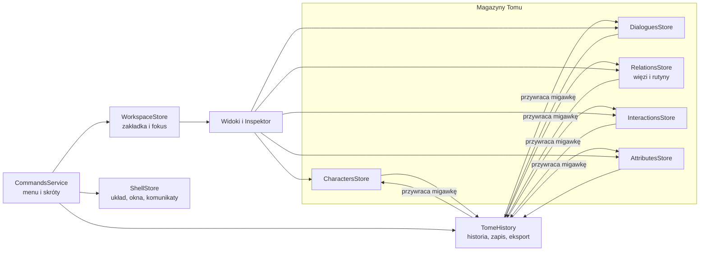

# Congulatio

> Kuźnia światów RPG: twórz postacie i ich trójwymiarowe sylwetki, pisz rozgałęzione dialogi, planuj rutyny dnia,
> mapuj relacje i interakcje, a potem sprawdź w symulacji, jak bohaterowie o różnych motywacjach rozegrają scenę.

Congulatio to aplikacja webowa (Angular 22) dla projektantów gier fabularnych. Cały świat — postacie, dialogi, więzi,
rutyny, interakcje i własne atrybuty — mieszka w jednym **Tomie**, który ma pełną historię zmian z cofaniem i
ponawianiem, zapis w przeglądarce oraz eksport i import do pliku JSON.

Projekt powstał jako praca uczelniana. Autor: **Adrian Blasiak**.

Pojęcia świata (Tom, dusza, rutyna, interakcja, scena…), zależności między nimi oraz reguły pierwszeństwa opisuje
[słownik pojęć](docs/glossary.md).

---

## Spis treści

1. [Najważniejsze funkcje](#najważniejsze-funkcje)
2. [Szybki start](#szybki-start)
3. [Skrypty npm](#skrypty-npm)
4. [Skróty klawiszowe](#skróty-klawiszowe)
5. [Architektura](#architektura)
6. [Model danych i plik Tomu](#model-danych-i-plik-tomu)
7. [Story AI (Chrome Prompt API)](#story-ai-chrome-prompt-api)
8. [Animacje z Mixamo](#animacje-z-mixamo)
9. [Testy](#testy)
10. [Wdrożenie na GitHub Pages](#wdrożenie-na-github-pages)
11. [Wydajność i budżety](#wydajność-i-budżety)
12. [Dostępność](#dostępność)
13. [Konwencje projektu](#konwencje-projektu)
14. [Znane ograniczenia](#znane-ograniczenia)
15. [Wykorzystanie AI](#wykorzystanie-ai)
16. [Autor i licencja](#autor-i-licencja)

---

## Najważniejsze funkcje

Interfejs aplikacji jest w języku angielskim; poniżej nazwy elementów podano tak, jak wyglądają w aplikacji.

### Lewy panel (nawigatory)

| Sekcja | Co robi |
| --- | --- |
| **Codex of Characters** | Lista wszystkich postaci („dusz”) z portretem, rasą, poziomem i statusem. Kliknięcie ładuje postać do Kuźni i Inspektora. Kosz (lub Delete) usuwa duszę po potwierdzeniu w oknie, które w akordeonach pokazuje wszystko, co odejdzie razem z nią: więzi, interakcje, rutyny osobiste, udział w rutynach globalnych i sceny, w których mówi (do wyboru). |
| **Routine Almanac** | Globalne rutyny świata (np. dzień targowy, nocna warta): pora dnia, harmonogram, miejsce, liczba uczestników. Dodawanie, edycja i usuwanie z walidacją. |
| **Attribute Ledger** | Własne atrybuty (klucz, nazwa, zakres, wartość domyślna, opis) obok sześciu podstawowych (STR, DEX, INT, WIS, CON, CHA). |
| Dialogue Threads, Quest Board, World Atlas | Miejsca zarezerwowane na kolejne moduły — na razie puste. |

Sekcje można otwierać jednocześnie, zmieniać ich wysokość przeciąganiem separatora (podwójne kliknięcie wyrównuje) i
szerokość całego panelu przeciąganiem prawej krawędzi.

### Zakładki główne

| Zakładka | Co robi |
| --- | --- |
| **Character** (Kuźnia) | „Summon Soul” losuje spójną postać (imię, rasa, cechy, znak zodiaku zgodny z datą urodzenia, portret 8-bit). Edycja tożsamości i wyglądu, zapis do Kodeksu z komunikatem sukcesu lub błędu. |
| **Sculptor** | Low-poly model 3D (three.js): suwaki z zakresami (wzrost, tusza, oczy, nogi, ręce, dłonie, klatka piersiowa u kobiet), presety sylwetki, fryzury i kolory włosów, **Make Avatar** (zrzut głowy jako portret postaci) oraz odtwarzanie animacji z Mixamo. |
| **Dialogue** | Trzy podzakładki: **Tree** (płaska lista scen z poziomami, filtrami i przypiętymi etykietami scen), **Story Composer** (pisanie gałęzi oraz panel Story AI) i **Variants & Impact** (warianty tonu, wpływ na ekonomię, środowisko i nastawienie, wspólne cele i przeszkody z autouzupełnianiem). |
| **Routines** | Plan dnia wybranej postaci od świtu do północy: dołączanie do rutyn globalnych, tworzenie rutyn osobistych, rozgałęzienia rutyn w dialogi, wykrywanie kolizji w tej samej porze. |
| **Interactions** | Rejestr interakcji (walka, handel, zadanie, zaklęcie, kradzież, rozmowa, prezent, groźba): źródło, cel, wyzwalacz z autouzupełnianiem, powiązany dialog, filtry i sortowanie. |
| **Relations** | Mapa relacji (SVG): dusze, rutyny i dialogi, w które rutyny się rozgałęziają. Wędrówka po powiązaniach, tworzenie i zrywanie więzi. |
| **Simulation** | Wybór scenariusza, postaci i motywacji (bogactwo, honor, bezpieczeństwo, ciekawość, więzi, władza). Postać wybiera opcje zgodnie z motywami i temperamentem, rozmówcy odpowiadają wariantem tonu wynikającym z relacji, a wynik sumuje wpływ na świat. |

### Drzewo dialogów (Tree)

- Każdy krok pokazuje poziom (L1–L5), typ interakcji („Started conversation”, „Reacted”, „Stole an item”…), mówiącego,
  tekst, wpływ oraz uporządkowaną listę **następnych kroków**. Kliknięcie przewija do celu i podświetla go.
- **Filtry:** dusze biorące udział (multiselect), tekst (każde słowo osobno, z podświetleniem trafień), sceny
  połączone lub samodzielne, tylko linie lub tylko opcje, typ interakcji, szkice AI, kroki z wpływem, zakres poziomów
  „od–do”.
- **Kolejność:** czytania albo **według poziomów** (rodzeństwo obok siebie, łatwe porównanie opcji).
- **Przypięte etykiety scen:** każda scena ma kolorowy pasek z numerem, identyfikatorem i tytułem, który zostaje
  widoczny podczas przewijania (jak zamrożone okienko).
- **Usuwanie kroków:** okno z akordeonem gałęzi i polami wyboru. Zaznaczone kroki są usuwane, a pozostawione kroki,
  których rodzic zniknął, stają się **samodzielnymi scenami**. Podsumowanie pokazuje też odcięte rozgałęzienia rutyn
  i interakcje, które przestaną otwierać dialog.
- **Samodzielne linie:** nowa linia lub opcja bez rodzica, od której można dalej pisać.

### Inspektor (prawy panel)

Pokazuje i edytuje to, co jest aktualnie w **fokusie** — duszę, rutynę, krok dialogu lub interakcję. Fokus ustawiają
Kodeks, Kuźnia, mapa relacji, lista dialogów, Rzeźbiarz, Symulacja i wyszukiwarka, a mapa i lista dialogów same
podążają za zmianą fokusu.

- Dusza: poziom, status, temperament, pochodzenie, atrybuty podstawowe i własne, relacje, rutyny, sceny, interakcje.
- **Atrybuty:** kliknięcie liczby kopiuje oznaczony token, np. `[[Aldric Blackwood.STR=78]]`; podwójne kliknięcie
  pozwala wpisać dokładną wartość (Enter zapisuje, Esc anuluje, wartość jest sprawdzana względem zakresu).
- **Tryb tylko do odczytu** (kłódka w nagłówku): dane jako zwykły tekst, bez możliwości edycji; linki, nawigacja i
  kopiowanie działają dalej. Ustawienie jest zapamiętywane w przeglądarce.

### Tom, historia i menu

- **File:** zapis Tomu wraz z dziennikiem zmian w przeglądarce, otwarcie Tomu z pliku, eksport (z pełną historią lub
  bez), reset do danych przykładowych (z potwierdzeniem; reset da się cofnąć).
- **Edit:** cofnij i ponów dla wszystkich danych oraz okno **History & changeset** z osią czasu i powrotem do dowolnego
  kroku. Szybkie serie edycji (pisanie, przeciąganie suwaka) są łączone w jeden krok.
- **View:** pokazywanie i ukrywanie paneli, tryb tylko do odczytu Inspektora, **presety układu** z dobranymi
  szerokościami paneli, maksymalizacja sceny, pełny ekran, przejście do zakładki.
- **Tools:** przywołanie losowej duszy, rzeźbienie duszy w fokusie, symulacja, mapa.
- **Help:** **Quick tour** (przewodnik krok po kroku oraz tabela skrótów budowana z tej samej listy poleceń, która
  obsługuje klawiaturę) i **About**.
- **Wyszukiwarka Tomu** w górnym pasku (⌘/Ctrl+K): postacie (`Imię Nazwisko (przydomek)`), linie, opcje, rutyny,
  więzi, interakcje i polecenia menu, każda kategoria z własnym kolorem etykiety. Wybór wyniku przenosi do właściwej
  sekcji.
- **Pasek stanu:** stan zapisu, krok historii, aktualny fokus, liczności Tomu oraz komunikaty.

---

## Szybki start

**Wymagania:** Node.js 26 (zob. `.nvmrc`) i npm 12 (zob. pole `packageManager` w `package.json`).

```bash
npm ci
npm start
```

Aplikacja uruchomi się pod adresem `http://localhost:4200/` i będzie przeładowywać się po każdej zmianie w kodzie.

Przy pierwszym uruchomieniu Tom zawiera dane przykładowe (pięć dusz, trzy sceny, rutyny, więzi, interakcje i dwa
własne atrybuty). Zapis (⌘/Ctrl+S) przechowuje Tom w `localStorage` przeglądarki.

---

## Skrypty npm

| Skrypt | Działanie |
| --- | --- |
| `npm start` | Serwer deweloperski (`ng serve`). |
| `npm run build` | Build produkcyjny do `dist/congulatio/browser`. |
| `npm run build:pages` | Build produkcyjny z `--base-href /congulatio/`, czyli tak jak na GitHub Pages. |
| `npm run watch` | Build deweloperski w trybie obserwowania zmian. |
| `npm test` | Testy jednostkowe (Vitest przez `ng test`) w trybie obserwowania. |
| `npm run test:ci` | Testy jednostkowe jednorazowo, bez obserwowania (używane w CI). |

---

## Skróty klawiszowe

Na macOS zamiast Ctrl używaj ⌘, a zamiast Alt — ⌥. Pełna, zawsze aktualna lista jest w aplikacji: **Help → Quick
tour → Shortcuts** (F1).

| Działanie | Skrót |
| --- | --- |
| Zapisz Tom | Ctrl+S |
| Otwórz Tom z pliku | Ctrl+O |
| Eksportuj Tom | Ctrl+Shift+E |
| Cofnij / Ponów | Ctrl+Z / Ctrl+Shift+Z lub Ctrl+Y |
| Historia i dziennik zmian | Ctrl+Shift+H |
| Szukaj w Tomie | Ctrl+K |
| Panel Kodeksu / Inspektor | Ctrl+B / Ctrl+Alt+B |
| Inspektor tylko do odczytu | Ctrl+Alt+R |
| Maksymalizuj scenę / Pełny ekran | Ctrl+Alt+M / Ctrl+Alt+F |
| Zakładki 1–7 (Character … Simulation) | Alt+1 … Alt+7 |
| Przywołaj losową duszę | Ctrl+Alt+N |
| Szybki przewodnik | F1 lub ? |
| Usuń krok dialogu (w drzewie) lub duszę (w Kodeksie) | Delete |

Cofnij i ponów celowo nie działają wewnątrz pól tekstowych — tam obowiązuje natywne cofanie przeglądarki. W menu,
listach, zakładkach i polach z podpowiedziami działają strzałki, Home/End, Enter i Esc.

---

## Architektura

### Stos technologiczny

| Obszar | Technologia |
| --- | --- |
| Framework | Angular 22 (komponenty standalone, sygnały, nowa składnia szablonów `@if` / `@for` / `@defer`, API `animate.enter`) |
| Stan | NgRx Signals (`signalStore`) i serwisy oparte na sygnałach |
| 3D | three.js 0.180 (`OrbitControls`, `FBXLoader`) |
| Ikony | Lucide |
| Style | CSS z tokenami motywu w `src/styles.css`, Tailwind CSS 4 (tylko warstwa bazowa) |
| Testy | Vitest 5 + jsdom przez `@angular/build:unit-test` |
| Język | TypeScript 6 |

`primeng` i `@primeuix/themes` są zainstalowane, ale obecnie nigdzie nieużywane.

### Struktura katalogów

```text
src/app/
├── domain/              czyste funkcje i typy domenowe (bez Angulara) + testy
├── store/               stan aplikacji: magazyny NgRx Signals i serwisy
├── layout/              górny pasek, menu, wyszukiwarka, okna dialogowe, pasek stanu, polecenia i skróty
├── ui/                  współdzielone komponenty UI (panel, przyciski, zakładki, modal, comboboxy, awatar)
├── navigator/           lewy panel i jego sekcje
├── characters-galery/   Codex of Characters
├── routines-almanac/    Routine Almanac (rutyny globalne)
├── attribute-ledger/    Attribute Ledger (własne atrybuty)
├── character-editor/    Kuźnia postaci
├── sculptor/            Rzeźbiarz 3D
├── dialogue-workbench/  zakładka Dialogue (Tree, Story Composer, Variants & Impact)
├── dialogue-list/       płaska lista dialogów z filtrami
├── dialogue-impact/     edytor wariantów i wpływu
├── story-ai/            panel Story AI
├── character-routines/  zakładka Routines (plan dnia postaci)
├── interactions-editor/ zakładka Interactions
├── relation-graph/      mapa relacji
├── scenario-simulator/  zakładka Simulation
├── inspector/           Inspektor
└── dialogue-editor/     wcześniejszy edytor węzłowy („Dialogue Loom”), obecnie odłożony
```

### Przepływ stanu



- **Magazyny Tomu** przechowują dane jako niezmienne tablice. Każda zmiana tworzy nową tablicę, dzięki czemu migawkę
  Tomu da się porównać przez równość referencji.
- **`TomeHistory`** obserwuje wszystkie magazyny Tomu, po krótkiej przerwie (450 ms) zapisuje migawkę z opisem zmian
  (np. „Edited soul Aldric Blackwood”), obsługuje cofanie, ponawianie i skoki w historii (do 200 kroków w pamięci),
  zapis w `localStorage`, eksport i import pliku oraz reset.
- **`WorkspaceStore`** trzyma aktywną zakładkę i obiekt w fokusie (dusza, rutyna, krok dialogu, interakcja).
- **`ShellStore`** odpowiada za układ (widoczność i szerokość paneli, presety, maksymalizację, pełny ekran, tryb tylko
  do odczytu), otwarte okno dialogowe i komunikaty paska stanu. Układ jest zapamiętywany w przeglądarce.
- **`CommandsService`** to jedna lista poleceń, z której korzystają menu, skróty klawiszowe, wyszukiwarka i tabela
  skrótów w przewodniku.
- **`StoryAi`** opakowuje wbudowany w Chrome `LanguageModel`.

### Warstwa domenowa (`src/app/domain`)

Logika jest pisana jako czyste funkcje, które łatwo testować: generowanie postaci i twarzy pikselowych, sylwetki i
rig 3D, retargeting animacji Mixamo, symulacja scenariuszy, planowanie usuwania dialogów i klasyfikacja scen,
wyszukiwanie i podświetlanie, budowanie i parsowanie promptów Story AI, opis zmian i walidacja plików Tomu, walidacja
rutyn, interakcji i atrybutów.

---

## Model danych i plik Tomu

Migawka Tomu (`TomeSnapshot`):

| Pole | Zawartość |
| --- | --- |
| `characters` | Dusze: tożsamość, wygląd, temperament, poziom, status, notatka, twarz 8-bit, opcjonalnie sylwetka 3D, fryzura, portret (data URL), atrybuty podstawowe i własne. |
| `dialogue` | Kroki dialogu: `id`, `parentId` (`null` = początek sceny), `kind` (`line` lub `choice`), `speaker`, `text`, opcjonalnie warianty, wpływ, typ interakcji, znacznik szkicu AI. |
| `relations` | Więzi między duszami (`kin`, `ally`, `rival`, `bond`, `mentor`) z notatką. |
| `routines` | Rutyny: nazwa, harmonogram, pora dnia, zasięg (`global` lub `personal` z właścicielem), miejsce, notatka, uczestnicy, rozgałęzienia w kroki dialogu. |
| `interactions` | Interakcje: rodzaj, źródło, cel (`player` lub id duszy), wyzwalacz, powiązany krok dialogu, notatka. |
| `attributeDefs` | Definicje własnych atrybutów: klucz, nazwa, zakres, wartość domyślna, opis. |

Plik eksportu (`congulatio-tome-RRRR-MM-DD-GG-MM.json`):

```json
{
  "format": "congulatio-tome",
  "version": 1,
  "exportedAt": "2026-10-25T13:45:00.000Z",
  "tome": { "characters": [], "dialogue": [], "relations": [], "routines": [], "interactions": [], "attributeDefs": [] },
  "changeset": [{ "id": 2, "label": "Edited soul Aldric Blackwood", "details": [], "at": "…" }],
  "history": { "index": 3, "entries": [] }
}
```

- `changeset` to dziennik zmian (etykiety i czasy), `history` pojawia się tylko przy eksporcie z historią i zawiera
  pełne migawki, dzięki czemu po imporcie można dalej cofać.
- Import sprawdza format, wersję i każdy wpis; uszkodzony plik daje czytelny komunikat zamiast awarii.
- Starsze pliki bez `interactions` lub `attributeDefs` nadal się otwierają (brakujące listy są puste).
- W `localStorage` przechowywane są klucze `congulatio.tome.v1` (Tom i dziennik zmian) oraz `congulatio.layout.v1`
  (układ paneli).

---

## Story AI (Chrome Prompt API)

Panel **Story AI** w Story Composer korzysta z modelu językowego wbudowanego w Chrome
([Prompt API](https://developer.chrome.com/docs/ai/prompt-api)). Model działa **lokalnie na urządzeniu** — treść
Tomu nie jest wysyłana na żaden serwer.

- **Next steps:** 2–4 opcje gracza z odpowiedziami od kroku, z którego piszesz, z opcjonalną wskazówką.
- **New scene:** scena dla wybranej duszy i tematu.
- **Polish my line:** przepisanie własnej linii głosem mówiącego.
- Model dostaje profil mówiącego, jego więzi, dotychczasową rozmowę i istniejące gałęzie; odpowiedzi są wymuszane
  schematem JSON i walidowane. Szkice trafiają do edytowalnego podglądu z polami wyboru, a dodanie do Tomu jest jednym
  krokiem historii. Kroki wygenerowane są oznaczone w drzewie jako „AI draft”.

**Wymagania:** desktopowy Chrome z Prompt API, ok. 22 GB wolnego miejsca oraz GPU z ponad 4 GB VRAM albo 16 GB RAM i
4 rdzenie CPU. Pierwsze pobranie modelu wymaga kliknięcia (przycisk **Download model**, z paskiem postępu). W innych
przeglądarkach panel wyjaśnia, dlaczego jest niedostępny, a pisanie ręczne działa normalnie. Stan modelu można
sprawdzić pod `chrome://on-device-internals`.

---

## Animacje z Mixamo

[Mixamo](https://www.mixamo.com/) nie udostępnia publicznego API (wymaga logowania Adobe), dlatego integracja działa
przez pliki:

1. Na mixamo.com wybierz animację i pobierz ją jako **FBX Binary** (najwierniej działa opcja **With Skin**).
2. W **Sculptor → Animate** wczytaj jeden lub kilka plików `.fbx`.
3. Odtwarzaj, zatrzymuj i usuwaj animacje; opcja **Keep in place** blokuje przesuwanie postaci.

Figura w Rzeźbiarzu ma stawy nazwane jak szkielet Mixamo i jest zbudowana w pozie T, a ruch jest przenoszony przez
różnice obrotów w przestrzeni świata, więc niezależnie od orientacji kości w pliku.

---

## Testy

```bash
npm run test:ci
```

Testy jednostkowe (Vitest, środowisko jsdom) obejmują:

- historię Tomu: cofanie, ponawianie, gałąź ponawiania, skoki, reset, zapis;
- pliki Tomu: walidację, uszkodzone wpisy, zgodność ze starszymi plikami, opis zmian;
- wyszukiwarkę Tomu oraz podświetlanie trafień;
- planowanie usuwania dialogów i klasyfikację scen (połączone / samodzielne);
- rutyny (pory dnia, walidacja), własne atrybuty (walidacja, wiersze, tokeny, wartości);
- budowanie promptów i parsowanie odpowiedzi Story AI;
- uruchomienie aplikacji i Kodeksu.

Testów end-to-end nie skonfigurowano.

---

## Wdrożenie na GitHub Pages

Workflow `.github/workflows/deploy-pages.yml` przy każdym pushu na `master` (lub ręcznie z zakładki Actions):

1. instaluje zależności tą wersją npm, która jest zapisana w `packageManager`;
2. uruchamia testy jednostkowe;
3. buduje aplikację z `--base-href` wyliczonym z nazwy repozytorium (`/<repozytorium>/`, a dla repozytorium
   `<użytkownik>.github.io` — `/`);
4. dodaje `404.html` (kopię `index.html`) i `.nojekyll`;
5. publikuje `dist/congulatio/browser` na GitHub Pages.

**Jednorazowa konfiguracja:**

1. Utwórz repozytorium na GitHubie i dodaj je jako zdalne:
   `git remote add origin git@github.com:<użytkownik>/<repozytorium>.git`.
2. Wypchnij gałąź `master` razem z tagiem wydania: `git push -u origin master --follow-tags`.
3. W repozytorium wejdź w **Settings → Pages** i jako **Source** wybierz **GitHub Actions**.
4. Po zakończeniu workflow strona będzie dostępna pod `https://<użytkownik>.github.io/<repozytorium>/`.

Podgląd lokalny tak jak na Pages: `npm run build:pages` (zakłada repozytorium o nazwie `congulatio`), a następnie
serwowanie katalogu `dist/congulatio/browser` pod ścieżką `/congulatio/`.

Na GitHub Pages wszystkie projekty jednego użytkownika dzielą domenę, więc dzielą też `localStorage`. Klucze
aplikacji mają prefiks `congulatio.`, żeby nie kolidowały z innymi stronami.

---

## Wydajność i budżety

- Budżet paczki startowej: ostrzeżenie powyżej 500 kB, błąd powyżej 1 MB (obecnie ok. 480 kB, ok. 125 kB po
  kompresji).
- Zakładki inne niż domyślna Character, okna dialogowe oraz Rzeźbiarz (z three.js, ok. 630 kB) ładują się dopiero przy
  pierwszym otwarciu (`@defer`).
- Budżet stylów komponentu: ostrzeżenie powyżej 8 kB, błąd powyżej 10 kB.

---

## Dostępność

- Pełna obsługa klawiaturą: menu (role `menubar` / `menu`), zakładki (`tablist` ze strzałkami, Home i End), comboboxy
  z listami (`combobox` / `listbox`, `aria-activedescendant`), modale na natywnym `<dialog>` z pułapką fokusu i Esc.
- Komunikaty o sukcesie i błędach trafiają do regionów `aria-live`.
- Zwinięte zakładki mają etykiety dostępne dla czytników ekranu i podpowiedzi.

---

## Konwencje projektu

Zasady dla ludzi i agentów AI są w [`AGENTS.md`](AGENTS.md) — razem z mapą zależności, która mówi, co jeszcze trzeba
zmienić przy dodawaniu, zmianie nazwy lub usuwaniu danego elementu. Znaczenie pojęć opisuje
[słownik](docs/glossary.md). Najważniejsze zasady:

- **Bez komentarzy w kodzie** (TS, HTML, CSS) — kod ma się tłumaczyć nazwami.
- **Conventional Commits** (`feat:`, `fix:`, `ci:`, `chore:`, `docs:`…), małe commity, jeden na logiczną zmianę.
- Logika domenowa jako czyste funkcje w `src/app/domain` z testami.
- Każda zmiana danych przechodzi przez magazyny Tomu, żeby trafiła do historii.

---

## Znane ograniczenia

- Pełna historia cofania żyje w pamięci; po przeładowaniu strony wcześniejsze kroki są widoczne tylko jako dziennik
  („Earlier sessions”). Aby zachować możliwość cofania między sesjami, użyj **Export tome with history**.
- `localStorage` mieści ok. 5 MB; przy bardzo dużym Tomie (np. wielu portretach) zapis może się nie udać — aplikacja
  poprosi wtedy o eksport do pliku.
- Story AI działa tylko w desktopowym Chrome spełniającym wymagania sprzętowe.
- Przenoszenie animacji Mixamo sprawdzono testem na sztucznym szkielecie; nietypowe pliki FBX mogą wymagać korekt.
- Sekcje Dialogue Threads, Quest Board i World Atlas oraz edytor węzłowy dialogów są na razie zaślepkami.
- Brak testów end-to-end.

Plan dalszych prac jest w [`TODO.md`](TODO.md).

---

## Wykorzystanie AI

Część aplikacji powstała z pomocą asystenta AI (Claude, Anthropic). Pomysł, wymagania, decyzje projektowe oraz
przegląd i akceptacja każdej zmiany należą do autora, który ponosi odpowiedzialność za ostateczny kształt pracy.
Dodatkowo funkcja Story AI w samej aplikacji korzysta z modelu językowego wbudowanego w Chrome, a wygenerowane przez nią
kroki dialogu są oznaczane jako „AI draft”.

---

## Autor i licencja

**Adrian Blasiak** — projekt uczelniany.

Licencja nie została jeszcze wybrana; do tego czasu wszelkie prawa zastrzega autor.
