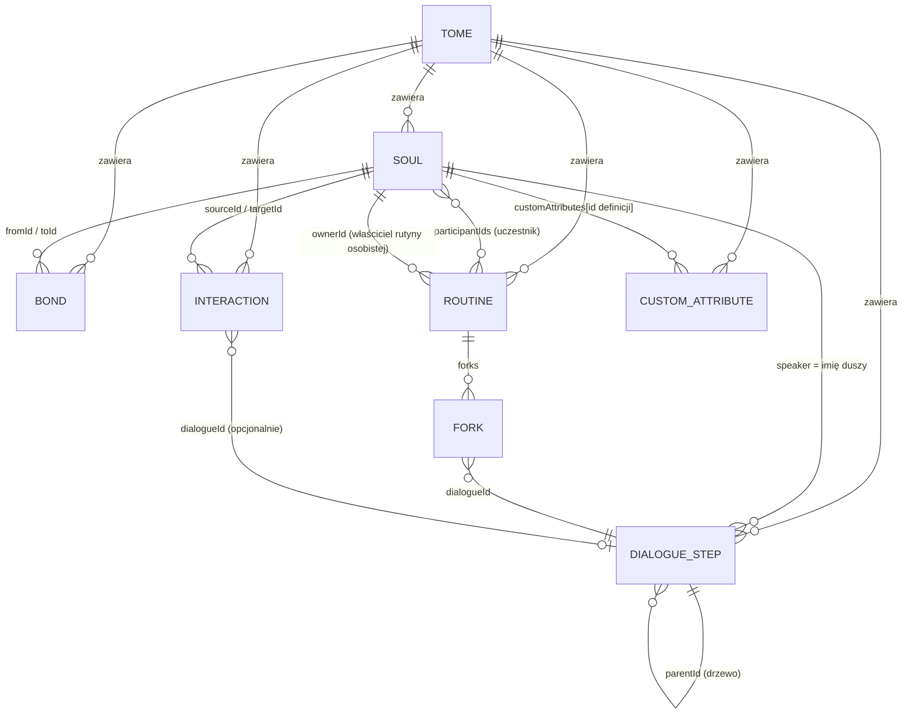

# Słownik pojęć i zależności

Ten dokument opisuje świat Congulatio: czym są poszczególne pojęcia, jak się ze sobą łączą i jakie reguły nimi
rządzą. Nazwy w nawiasach to nazwy z interfejsu (angielskiego) oraz typy w kodzie.

Oznaczenia statusu reguł:

- ✅ **egzekwowane** — aplikacja pilnuje tej reguły w kodzie,
- 🧭 **reguła projektowa** — tak należy projektować świat i tak ma działać docelowo, ale kod jeszcze tego nie wymusza,
- ⚠️ **znana luka** — obecne zachowanie odbiega od reguły.

---

## Spis treści

1. [Mapa pojęć](#mapa-pojęć)
2. [Tom i historia](#tom-i-historia)
3. [Dusze i ich cechy](#dusze-i-ich-cechy)
4. [Więzi](#więzi)
5. [Rutyny](#rutyny)
6. [Interakcje](#interakcje)
7. [Dialogi](#dialogi)
8. [Symulacja](#symulacja)
9. [Przestrzeń robocza](#przestrzeń-robocza)
10. [Pierwszeństwo i rozstrzyganie konfliktów](#pierwszeństwo-i-rozstrzyganie-konfliktów)
11. [Co się dzieje przy usuwaniu](#co-się-dzieje-przy-usuwaniu)
12. [Dwa różne „interaction”](#dwa-różne-interaction)

---

## Mapa pojęć

Najkrócej:

- **Tom** to cały świat, zapisywany i cofany jako całość.
- **Dusza** to postać. Ma cechy, atrybuty, sylwetkę 3D i portret.
- **Więź** łączy dwie dusze.
- **Rutyna** to stała, codzienna czynność w określonej porze dnia; może **rozgałęziać się** w dialog.
- **Interakcja** to zdarzenie wywoływane **wyzwalaczem**; może otworzyć dialog i ma pierwszeństwo przed rutyną.
- **Dialog** to drzewo kroków (linii i opcji). Każde drzewo to **scena**.

---

## Tom i historia

### Tom (Tome, `TomeSnapshot`)

Cały świat jednego projektu: dusze, dialogi, więzi, rutyny, interakcje i definicje własnych atrybutów. Tom jest
jednostką zapisu, eksportu, importu, resetu i historii. ✅ Każda zmiana danych świata przechodzi przez magazyny Tomu,
więc trafia do historii.

### Migawka (snapshot)

Niezmienny stan Tomu w danej chwili. Dwie migawki są równe, gdy ich listy są tymi samymi obiektami (porównanie
referencji), dlatego dane zawsze zmienia się przez tworzenie nowych list, a nie modyfikację istniejących.

### Krok historii (history entry)

Migawka z opisem zmiany (np. „Edited soul Aldric Blackwood”) i czasem. Szybkie serie edycji w odstępach krótszych niż
450 ms łączą się w jeden krok. W pamięci mieści się 200 kroków; starsze przechodzą do dziennika.

### Dziennik zmian (changeset)

Lista etykiet i czasów kroków historii, bez migawek. Zapisywany razem z Tomem w przeglądarce i dołączany do eksportu.
Kroki z wcześniejszych sesji są widoczne jako „Earlier sessions”, ale nie da się do nich wrócić.

### Zapis, eksport, import, reset

- **Zapis** — Tom i dziennik zmian w `localStorage` przeglądarki.
- **Eksport** — plik JSON; **z historią** zawiera pełne migawki, więc po imporcie można dalej cofać.
- **Import** — zastępuje Tom zawartością pliku jako jeden krok historii (da się go cofnąć).
- **Reset** — przywraca dane przykładowe jako jeden krok historii (da się go cofnąć).

---

## Dusze i ich cechy

### Dusza (Soul, postać, `RandomCharacter`)

Postać świata: imię, nazwisko, przydomek, rasa, płeć, pochodzenie, znak zodiaku, data urodzenia, wiek, poziom,
typ budowy, karnacja, włosy, oczy, temperament, notatka, twarz 8-bit i status (`alive`, `quest`, `resting`).

### Kodeks (Codex of Characters)

Lista wszystkich dusz w Tomie (lewy panel).

### Kuźnia (Character Forge)

Edytor tożsamości i wyglądu duszy. „Summon Soul” losuje spójną postać. ✅ Kuźnia zapisuje tylko pola, które sama
edytuje; sylwetki, portretu, atrybutów i innych danych ustawionych gdzie indziej nie nadpisuje.

### Gracz (Player, `player`)

Postać sterowana przez gracza. Nie jest duszą w Kodeksie; w dialogach występuje jako mówiący `You`, a w interakcjach
jako identyfikator `player`.

### Temperament

Charakter duszy (np. Fierce, Wise, Kind). Wpływa na wyliczone atrybuty podstawowe i na wybory w symulacji.

### Atrybuty podstawowe (core attributes)

STR, DEX, INT, WIS, CON, CHA w zakresie 1–100. Jeśli nie ustawiono ich ręcznie, są wyliczane z rasy, temperamentu,
poziomu i identyfikatora duszy (zawsze tak samo dla tej samej duszy).

### Atrybut własny (custom attribute, `CustomAttribute`)

Atrybut zdefiniowany przez projektanta w **Attribute Ledger**: klucz (1–6 znaków, np. `LCK`), nazwa, zakres,
wartość domyślna, opis. ✅ Klucz jest unikalny i nie może pokrywać się z atrybutem podstawowym. Definicja jest
**globalna** (dotyczy wszystkich dusz), a **wartość** jest zapisywana osobno w każdej duszy; dusza bez zapisanej
wartości ma wartość domyślną.

### Token atrybutu

Oznaczony zapis wartości kopiowany kliknięciem w Inspektorze, np. `[[Aldric Blackwood.STR=78]]`. To zwykły tekst — nie
aktualizuje się, gdy wartość lub nazwa się zmieni.

### Sylwetka (build), wygląd (appearance), portret (portrait)

- **Sylwetka** — proporcje ciała z Rzeźbiarza (rozmiar, tusza, oczy, nogi, ręce, dłonie, klatka piersiowa).
- **Wygląd** — fryzura i kolor włosów modelu 3D.
- **Portret** — obraz zrobiony przyciskiem „Make Avatar”; zastępuje twarz 8-bit w Kodeksie, Kuźni i Inspektorze.

---

## Więzi

### Więź (bond, relation, `CharacterRelation`)

Trwały związek dwóch dusz z rodzajem i notatką:

| Rodzaj | Znaczenie | Wpływ na ton w symulacji |
| --- | --- | --- |
| `kin` | rodzina | ciepły |
| `ally` | sojusznik | ciepły |
| `bond` | bliska więź, uczucie | ciepły |
| `mentor` | mistrz i uczeń | ciepły |
| `rival` | rywal | wrogi |

✅ Dwie dusze mogą mieć najwyżej jedną więź (w dowolnym kierunku). 🧭 Więź jest symetryczna w skutkach, choć zapisuje
się ją od jednej duszy do drugiej.

---

## Rutyny

### Rutyna (routine, `Routine`)

**Stała, powtarzalna czynność dnia** — coś, co dusza robi zwykle o tej samej porze, np. dzień targowy o świcie albo
nocna warta. Rutyna ma nazwę, harmonogram („every day”, „market days”), porę dnia, miejsce, notatkę, uczestników i
rozgałęzienia w dialog.

### Rutyna globalna (global routine)

Rutyna wspólna dla świata, definiowana w **Routine Almanac**. Każda dusza może do niej **dołączyć** lub z niej
**wyjść**. Zmiana rutyny globalnej dotyczy wszystkich jej uczestników. ✅ Nazwa rutyny globalnej jest unikalna.

### Rutyna osobista (personal routine, local)

Rutyna należąca do jednej duszy (`ownerId`), definiowana w zakładce **Routines**. ✅ Nazwa jest unikalna w obrębie
właściciela; różne dusze mogą mieć rutyny osobiste o tej samej nazwie. Rutyna bez określonego zasięgu jest traktowana
jako globalna.

### Pora dnia (time slot)

Jeden z ośmiu przedziałów: Dawn (5–7), Morning (7–11), Midday (11–14), Afternoon (14–17), Dusk (17–19), Evening
(19–22), Night (22–24), Midnight (0–5). Jeśli rutyna nie ma ustawionej pory, wyznacza się ją ze słów w harmonogramie
(np. „Dusk, every Moonday” → Dusk; bez dopasowania → Morning).

### Uczestnik (participant, keeper)

Dusza, która „utrzymuje” rutynę (`participantIds`).

### Rozgałęzienie (fork, `RoutineFork`)

Moment rutyny, który otwiera dialog: etykieta (np. „A challenger arrives”) i krok dialogu (`dialogueId`). ✅ Każde
rozgałęzienie musi mieć etykietę i wskazywać krok dialogu.

### Kolizja (clash)

Dwie rutyny jednej duszy w tej samej porze dnia. ✅ Plan dnia oznacza kolizję, ale jej nie rozstrzyga (zob.
[pierwszeństwo](#pierwszeństwo-i-rozstrzyganie-konfliktów)).

---

## Interakcje

### Interakcja (interaction, `Interaction`)

**Zdarzenie wywoływane wyzwalaczem** — coś, co jedna strona robi drugiej, gdy zajdzie warunek. Ma rodzaj, źródło,
cel, wyzwalacz, opcjonalny krok dialogu, który otwiera, i notatkę.

| Rodzaj | Przykład |
| --- | --- |
| Combat, Threat | walka, groźba |
| Trade, Gift | handel, prezent |
| Quest, Talk | zlecenie zadania, rozmowa |
| Spell | zaklęcie |
| Steal | kradzież |

### Wyzwalacz (trigger)

Warunek uruchamiający interakcję, np. „On greet”, „On HP < 20%”, „At nightfall”, „On item stolen”. Wpisywany dowolnie,
z podpowiedziami.

### Źródło i cel (source, target)

Dusze lub gracz. ✅ Źródło i cel muszą być różne i muszą istnieć w Kodeksie (albo być graczem).

---

## Dialogi

### Krok dialogu (dialogue step, `DialogueNode`)

Pojedynczy element rozmowy: **linia** (`line`) wypowiadana przez postać albo **opcja** (`choice`) do wyboru przez
gracza. Krok ma rodzica (`parentId`), więc kroki tworzą drzewo.

### Mówiący (speaker)

Napis z imieniem mówiącego. Dla opcji gracza to `You`. ⚠️ Dusza jest rozpoznawana jako mówiący po **imieniu**
(`firstName`), nie po identyfikatorze — zmiana imienia duszy odłącza ją od jej linii (w scenie, symulacji, Story AI i na
mapie relacji).

### Scena (scene)

Drzewo dialogu zaczynające się od kroku bez rodzica (`parentId: null`). Każda scena ma numer (S1, S2…), identyfikator
(identyfikator pierwszego kroku) i kolor.

### Scena połączona i samodzielna (connected, standalone)

- **Połączona** — rozgałęzienie rutyny albo interakcja prowadzi do któregoś z jej kroków.
- **Samodzielna** — nic do niej nie prowadzi. Powstaje np. z nowej „Standalone line” albo z kroków, które zostały,
  gdy usunięto ich rodzica.

### Poziom (level)

Głębokość kroku w scenie: L1 to początek sceny, L2 to jego dzieci itd.

### Następne kroki (next steps)

Dzieci danego kroku w kolejności zapisu — kolejne możliwe linie lub opcje.

### Typ interakcji kroku (dialogue interaction type)

Rola kroku w rozmowie: Started conversation, Continuation, Asked, Reacted, Traded, Stole an item, Threatened, Gave a
gift, Ended conversation. Wyznaczany automatycznie z pozycji i treści; można go nadpisać. **To coś innego niż wpis
w rejestrze interakcji** — zob. [Dwa różne „interaction”](#dwa-różne-interaction).

### Wariant (variant)

Inne sformułowanie kroku w tonie `warm`, `neutral` lub `hostile`. W symulacji mówiący wybiera wariant pasujący do
swojego nastawienia wobec rozmówcy.

### Wpływ (impact)

Skutki kroku dla świata: **ekonomia**, **środowisko**, **nastawienie** (od −3 do +3) oraz **wspólny cel** i
**przeszkoda** (tekst z podpowiedziami, np. „Coordinated attack”, „High fees”).

### Szkic AI (AI draft)

Krok wygenerowany przez Story AI i dodany do Tomu. Oznaczany w drzewie, filtrowany przełącznikiem „AI drafts”.

---

## Symulacja

### Scenariusz (scenario)

Scena wybrana do symulacji.

### Motywacja (motivation)

To, czym kieruje się dusza wybierająca opcje: Wealth, Honor, Safety, Curiosity, Kinship, Power. Do wybranych
motywacji dochodzi skłonność wynikająca z temperamentu.

### Wynik (outcome)

Przebieg rozmowy z uzasadnieniem wyborów oraz suma wpływu na ekonomię, środowisko i nastawienie, cele i przeszkody.
Symulacja nie zmienia Tomu.

---

## Przestrzeń robocza

### Fokus (focus)

Obiekt aktualnie oglądany: dusza, rutyna, krok dialogu albo interakcja. Fokus pokazuje Inspektor, a mapa relacji,
lista dialogów i inne widoki za nim podążają. Fokus nie jest częścią Tomu i nie trafia do historii.

### Inspektor (Inspector)

Prawy panel pokazujący i edytujący obiekt w fokusie. **Tryb tylko do odczytu** blokuje w nim każdą edycję.

### Polecenie (command)

Akcja dostępna z menu, skrótu klawiszowego i wyszukiwarki (np. zapis Tomu, przejście do zakładki). Jedna lista
poleceń zasila wszystkie te miejsca.

### Preset układu (layout preset)

Zapisany zestaw widoczności i szerokości paneli (Balanced, Writer, Codex focus, Map & inspector, Wide stage). Układ jest
ustawieniem przeglądarki, nie częścią Tomu.

---

## Pierwszeństwo i rozstrzyganie konfliktów

Gdy w tej samej chwili dusza mogłaby robić kilka rzeczy, obowiązuje kolejność (od najważniejszej):

1. **Interakcja** — zdarzenie wywołane wyzwalaczem przerywa wszystko inne. Po jej zakończeniu dusza wraca do rutyny.
   🧭
2. **Rutyna osobista** — ważniejsza od rutyny globalnej o tej samej porze, bo opisuje konkretną duszę. 🧭
3. **Rutyna globalna** — domyślna czynność świata. 🧭

Uzasadnienie: rutyna to plan, interakcja to reakcja na zdarzenie. Plan jest tłem, reakcja ma pierwszeństwo.

Stan w aplikacji: plan dnia w zakładce **Routines** pokazuje kolizje rutyn, a lista „Join a global routine” ostrzega,
gdy dusza jest już zajęta o tej porze, ale aplikacja nie rozstrzyga konfliktów automatycznie, a symulacja nie bierze
rutyn pod uwagę. Reguła jest wskazówką dla projektanta i kierunkiem dalszego rozwoju.

Inne reguły:

- Dwie interakcje tej samej duszy z tym samym wyzwalaczem — 🧭 rozstrzyga kolejność w rejestrze (wyżej na liście =
  ważniejsza).
- Wartość atrybutu: wartość zapisana w duszy ma pierwszeństwo przed domyślną z definicji. ✅
- Pora rutyny: jawnie ustawiona pora ma pierwszeństwo przed porą odczytaną z harmonogramu. ✅
- Ton odpowiedzi w symulacji: wynika z więzi (rywal = wrogi, inne = ciepły) przesuniętej o nastawienie zebrane w
  trakcie rozmowy. ✅

---

## Co się dzieje przy usuwaniu

| Usuwany obiekt | Skutki |
| --- | --- |
| **Krok dialogu** | ✅ Okno z akordeonem pozwala wybrać, które kroki poniżej też usunąć. Kroki pozostawione, których rodzic zniknął, stają się początkiem nowych scen samodzielnych. Rozgałęzienia rutyn prowadzące do usuniętych kroków są odcinane, a interakcje przestają otwierać dialog. |
| **Rutyna** (globalna lub osobista) | ✅ Znika z planu dnia wszystkich uczestników. Dialogi, do których prowadziła, zostają; jeśli nic innego do nich nie prowadzi, stają się samodzielne. |
| **Interakcja** | ✅ Znika z rejestru; dialog, który otwierała, zostaje. |
| **Atrybut własny** | ✅ Definicja znika; wartości zapisane w duszach zostają, ale są ignorowane (przywrócenie definicji przez cofnięcie przywraca też wartości). |
| **Więź** | ✅ Znika z mapy i z Inspektora obu dusz. |
| **Dusza** | ✅ Okno potwierdzenia pokazuje w akordeonach wszystko, co jest z nią związane. Razem z duszą znikają jej portret, sylwetka i wartości atrybutów, jej **więzi**, **interakcje**, w których jest źródłem lub celem, oraz jej **rutyny osobiste**. Z **rutyn globalnych** dusza tylko wychodzi — zostają dla innych. **Sceny**, w których mówi, można zaznaczyć do usunięcia (domyślnie zaznaczone; gdy inna dusza ma to samo imię — niezaznaczone); usunięcie sceny odcina też prowadzące do niej rozgałęzienia rutyn i powiązania interakcji. Niezaznaczone sceny zostają, a jej linie pozostają w nich jako tekst. |

Każde usunięcie jest jednym krokiem historii i da się je cofnąć.

---

## Dwa różne „interaction”

W aplikacji słowo „interaction” oznacza dwie różne rzeczy. Nie wolno ich mylić:

| | Wpis w rejestrze interakcji | Typ interakcji kroku dialogu |
| --- | --- | --- |
| Gdzie | zakładka **Interactions** | drzewo dialogów, **Variants & Impact** |
| Typ w kodzie | `Interaction` (`domain/interactions.ts`) | `InteractionKind` (`domain/dialogue.ts`) |
| Czym jest | zdarzenie między dwiema stronami z wyzwalaczem | rola kroku w rozmowie (np. „Reacted”) |
| Wartości | Combat, Trade, Quest, Spell, Steal, Talk, Gift, Threat | Started conversation, Continuation, Asked, Reacted, Traded, Stole an item, Threatened, Gave a gift, Ended conversation |
| W Tomie | lista `interactions` | pole `interaction` kroku dialogu |
